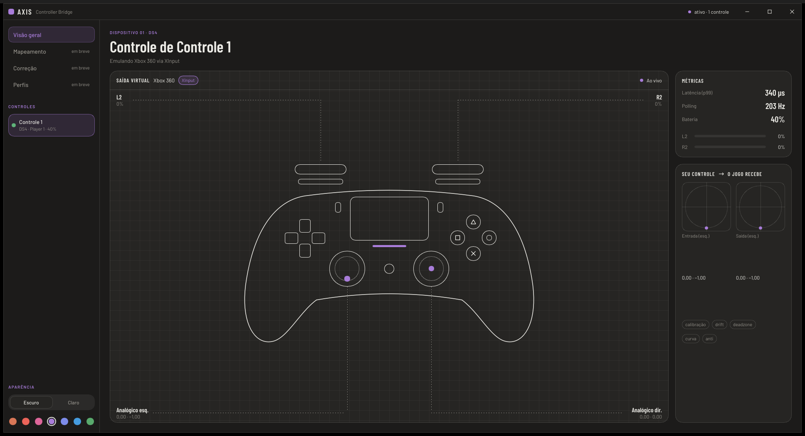

# Interface (axis-ui): verificação com o autor e medições

Data: 2026-11-10. Máquina do autor, Windows 11, build release (`C:/dev/cargo-target/axis/release`).
Controle: DualShock 4 (clone, MAC 41:42:00:00:84:B6) por Bluetooth, ~203 Hz.

## Roteiro (Task 10, passo 1)

| Verificação | Resultado |
|---|---|
| "Abrir o Axis" pela bandeja abre a janela | ok |
| Cartão do controle com família, player e bateria | ok ("DS4 · Player 1 · 40%") |
| Palco acompanha analógicos, gatilhos e botões | ok |
| Desligar o DS4 → "reconectando…", palco esmaecido e neutro | ok |
| Religar → volta ao vivo sem reabrir a janela | ok |
| Pausar pela bandeja → título muda para "pausado" (mensagem `State`) | ok, mas pouco visível (ajustado depois do teste) |
| Restaurar controles pela bandeja → notificação, emulação desligada | ok |
| Fechar a UI → núcleo continua e a amostragem para | ok (CPU do núcleo 0,000% em 10 s) |
| Duplo clique no ícone abre a UI na frente | ok |
| Abrir a UI com o núcleo parado → inicia o núcleo sozinha | ok (núcleo em 48 ms, controle volta como Player 1) |

## Medições (passo 2)

| Medida | Valor |
|---|---|
| Processo da UI até a janela existir | 19 ms (meta < 500 ms) |
| RAM da UI logo após abrir | 23,0 MB |
| RAM da UI com o palco animando | 36,1 MB |
| CPU da UI com o palco animando | 0,72% |
| CPU do núcleo inspecionando (UI aberta) | 0,08% (13,0 MB) |
| CPU do núcleo sem UI | 0,000% (19,0 MB) |
| Quadros `Live` recebidos pelo pipe | ~49/s (teto ~59/s pelo intervalo de 17 ms) |
| Latência p99 do núcleo sem UI | 70–80 µs |
| Latência p99 do núcleo com a UI animando | 80–340 µs (disputa de CPU com o desenho; bem abaixo de 1 ms) |

Modo demonstração (`AXIS_UI_DEMO=1`, sem núcleo): 0,48% de CPU e 22,7 MB animando a 60 Hz.

## Observações

- A latência na tela aparece como "—" até o primeiro minuto de medição, e fica "—" pausado ou só visualização.
- O cabeçalho mostra a família ("DISPOSITIVO 01 · DS4"); USB/Bluetooth depende de um campo `transport` no protocolo (adiado).
- Ajustes feitos após o teste e aprovados pelo autor: título sem "Controle de Controle 1"; estado pausado/só visualização destacado no palco (pílula âmbar `Tokens.warning`); pausa e retomada registradas no log do núcleo; cabeçalho do palco com fundo sólido; grade cobrindo todo o cartão; redimensionar pelas bordas com o botão esquerdo (`resize-border-width` 6 px, desligado maximizada).
